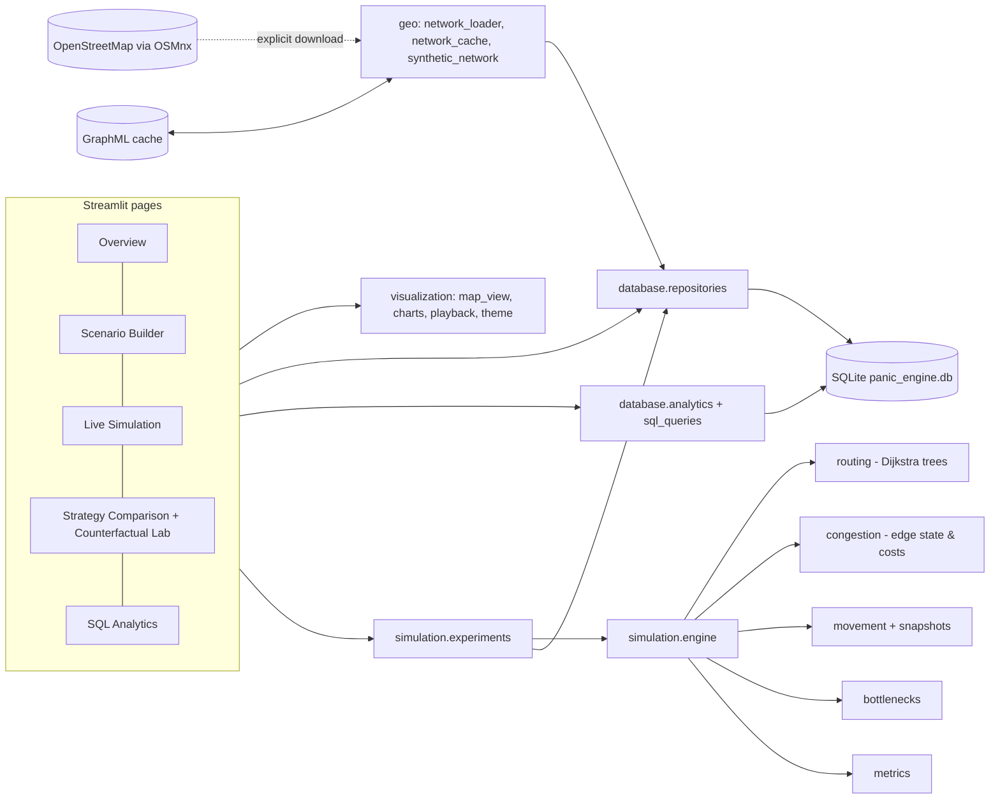
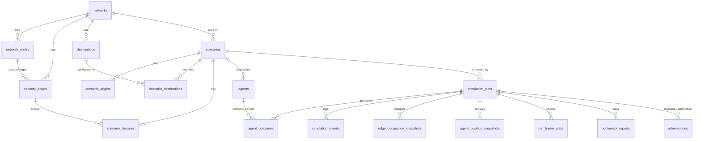
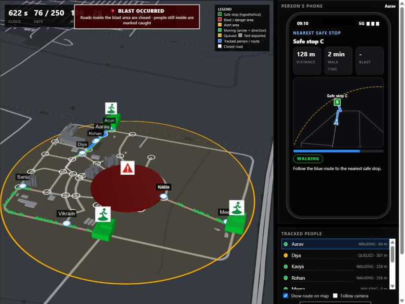

# PANIC ENGINE

**P**ython-based **A**gent **N**etwork for **I**ntelligent **C**rowd Evacuation and Incident Analysis

A college project combining **Python**, **SQL (SQLite)**, **graph algorithms (NetworkX)**, **OpenStreetMap geodata (OSMnx)**,
**agent-based simulation** and a **Streamlit dashboard**. Study area: Amrita Vishwa Vidyapeetham, Amaravati campus, the
Kuragallu–Nowluru area and the direction of Mangalagiri, Andhra Pradesh, India.

> **Status honesty.** This is an *educational simulation and preliminary decision-support prototype*. It is **not** an
> operational emergency-response system and has **not** been validated against real evacuations. No accuracy or
> real-world safety claim is made. Verified-by-execution facts are listed in [Verification status](#verification-status).

---

## 1. Abstract

PANIC ENGINE simulates crowds evacuating over a road graph. Each agent has an origin, a destination, a planned route and a
finite-state life-cycle. Roads have finite capacity, destinations have finite capacity and throughput, and roads can close
during the run. Three routing policies (free-flow shortest path, congestion-aware, centrally load-balanced) are compared on
identical populations. Every scenario, event, occupancy snapshot, outcome and bottleneck is stored in a normalised SQLite
database and analysed with SQL (joins, aggregation, window functions). A Counterfactual Evacuation Lab runs a baseline and a
modified world and records exactly what changed. The dashboard replays genuine simulation snapshots on an interactive map of
either real OpenStreetMap roads (cached, offline-capable) or a clearly labelled synthetic fallback network.

## 2. Problem statement

When an alert goes out, everyone is told to move to a safe place at the same moment. They pick the nearest exits and the same
roads, queues form, and some people run out of time before the strike. We ask: *how should people be routed, and how much warning
time is needed, so that most reach safety in time?* In the simulation everyone receives the alert on their phone, so the question
is about routing and warning time, not about who is reached. Under explicit, documented assumptions we compare three routing
strategies on identical crowds and report how many people reach safety and how many are caught in the blast.

## 3. Objectives

1. Load a road network from OpenStreetMap (cached) or fall back to a deterministic synthetic network.
2. Generate a reproducible synthetic population and let the user mark hypothetical origins, destinations and closures.
3. Simulate agents moving along graph edges with edge capacity, queues, destination throughput/capacity and closures.
4. Implement and compare three routing strategies with transparent edge-cost formulas.
5. Detect and explain bottlenecks (capacity-constrained segments, not merely busy ones).
6. Persist all experiments relationally and answer analytical questions with SQL.
7. Provide counterfactual (what-if) experiments with recorded modifications.
8. Check internal consistency automatically and test the system.

## 4. Features (implemented)

| Area | Implemented |
|---|---|
| Geodata | OSMnx download (explicit button/script), GraphML cache, offline reuse, largest weakly-connected-component cleaning, explicit in-app OSM download, synthetic fallback, OSM attribution |
| Simulation | timestep engine, FSM with validated transitions, edge capacity, node holding queues, BPR-style traversal time, destination capacity + throughput, mid-run closures, reroute on full destination |
| Routing | `SHORTEST_PATH`, `CONGESTION_AWARE`, `LOAD_BALANCED` (centralised planner) |
| SQL | 18 tables, FKs, CHECKs, indexes, versioned migrations, transactional persistence, 12+ analytical queries incl. window functions |
| Analysis | bottleneck detection with configurable thresholds, nine integrity checks, reproducibility check, paired + intervention comparisons, edge-level congestion diff |
| Dashboard | One page, four tabs (`app.py`): **Live simulation** (deck.gl 3-D map replayed in the browser, simulated phone, tracked people, manual control), **Analytics**, **Strategies** (paired runs, counterfactual lab, alert lead-time experiment), **SQL** (all queries, read-only console, integrity checks). **Quick controls at the top of the page**: path (routing strategy), walking speed, **RUN**, **COMPARE ALL 3** (runs the three strategies on the same crowd and tabulates who reached safety and who was caught) and **PHONE**. Sidebar: map, simulation, bomb areas, danger zones, people |
| Real phone view | `visualization/phone_server.py` starts a small LAN server (port 8765) when the app starts. A phone on the same Wi-Fi opens `http://<PC address>:8765/phone` (QR code under the **PHONE** button at the top of the page) and gets the alert screen, safe-stop route, mini-map and D-pad. Clock, selected person, names and the manual avatar stay in sync with the dashboard in both directions |
| Bomb alert drill | Bomb areas (blast radius, larger alert radius, strike time, warning lead time). At the alert time every phone inside the alert area gets an emergency alert; people react and walk to the nearest safe stop; at the strike roads/safe stops inside the blast radius are lost and anyone still inside is counted as *caught* (a simulated death in the results; nothing graphic is drawn). Events `ALERT_SENT` / `HAZARD_STRIKE` are stored in SQL |
| Alert channels + planner | Not everybody has a phone at hand. People are warned by **phone** (a chosen share), **siren** (radius around placed sirens) or a **neighbour** relay; people nobody reaches never start moving. The *Strategies → Alert planner* tab runs four paired simulations (phones only / + sirens / + neighbours / everyone has a phone), recommends siren sites for the people the phones missed (greedy max-coverage, outside the blast radius) and reports who was never alerted, safe before the blast and caught. The channel of each person is stored in SQL (`agents.alert_channel`) |
| Phone + person control | Per tracked person: alarm screen (siren, vibration, countdown), nearest safe stop with walking distance/time, live mini-map with route, trail and position. People can be renamed, followed, pointed at a specific safe stop, or taken over and walked with arrow keys / WASD / D-pad (what-if avatars; they do not change the stored run) |
| Scripts | `download_network`, `run_benchmarks`, `export_report` |

**Proposed future work (not implemented):** density-dependent walking speed from empirical data, social-force/panic
behaviour, building-level exits from surveyed data, vehicles, calibration against observed drills, multi-hazard spread
models, PostGIS backend, live data feeds.

## 5. Architecture



Separation of concerns: pages never write SQL (they call `repositories` / `analytics`); the engine never touches the
database or UI (it receives a `RoadNetwork` + `ScenarioConfig` and returns a `SimulationResult`); `experiments` is the only
place that joins the two.

```
panic_engine/
  app.py                             single-page Streamlit UI (3-D scene)
  config/settings.py                 paths, defaults, env overrides
  database/  schema.sql init_db.py connection.py repositories.py seed_data.py sql_queries.py analytics.py
  geo/       network_loader.py network_cache.py synthetic_network.py geographic_utils.py
  simulation/ models.py agent.py engine.py routing.py congestion.py movement.py snapshots.py
              bottlenecks.py metrics.py experiments.py
  visualization/ scene3d.py (pydeck 3-D) playback.py theme.py map_view.py/charts.py (2-D helpers, unused by the page)
  scripts/   download_network.py run_benchmarks.py export_report.py
  tests/     10 test modules (pytest)
  data/      (git-ignored runtime data: SQLite DB, GraphML cache)
```

## 6. Technology stack

Python 3.10+ · SQLite (`sqlite3`) · NetworkX · PyDeck · OSMnx (optional for real roads) · Folium + streamlit-folium · Plotly · Streamlit · Pandas/NumPy · pytest.
This revised copy was regression-tested in the available Python 3.13.5 environment; the real OpenStreetMap download was not re-verified in this environment.

## Real map setup (important)

The app can run without internet using the clearly labelled synthetic grid. To display the real campus-area road network:

1. Install the optional geospatial dependencies: `python -m pip install -r requirements-osm.txt`.
2. Launch the app: `streamlit run app.py`.
3. Open **Download real campus-area map** in the sidebar. The initial centre is an estimate; verify it against OpenStreetMap and adjust the latitude/longitude if necessary.
4. Start with 2-3 km (default 2.5 km). 6 km also works (about 7 000 nodes) but is much heavier and can time out on the public Overpass server; increase it only if the relevant streets are outside the area.
5. Click **DOWNLOAD REAL ROAD NETWORK** and wait for the cache to finish. The app will reload and select cached OpenStreetMap data by default.
6. If download fails, check the internet connection, install the optional dependencies, or retry later. Overpass services can be temporarily unavailable.

The live view draws keyless OpenStreetMap raster tiles as an optional basemap (Map: OSM dark / OSM light / None; internet needed). Carto's free tile CDN now answers "API KEY REQUIRED", so it is not used. Road geometry comes from OpenStreetMap. A destination generated by the app is still a **hypothetical simulation destination**, not an officially verified shelter or campus exit. Road capacities are estimates, not surveyed measurements.

The road converter retains the largest **weakly connected** component rather than discarding every road that is not in the largest strongly connected component. This preserves more legitimate pedestrian network branches; route reachability is still evaluated directionally by the simulation.

## 7. Database schema



Design decisions (details in `database/schema.sql`):

* **Network is separate from scenarios** and stored once per content fingerprint (`networks.network_id`), so reruns and
  repeated seeding never duplicate road data. Parallel edges are allowed (no unique `(source, target)`).
* **`agents` is the population (shared by all runs of a scenario); `agent_outcomes` holds the per-run result** (destination,
  final state, evacuation time, wait, last node/edge). This is what makes paired comparisons possible: several strategies run
  on literally the same agent rows. The brief's per-agent fields (destination, current node/edge, state, evacuation time, wait)
  therefore live in `agent_outcomes`, keyed by `(run_id, agent_id)`.
* **Per-scenario destination overrides** (`scenario_destinations`) let an intervention change capacity/throughput/availability
  without altering the destination definition; **closures** are scenario-level (`scenario_closures`).
* **Sparse occupancy snapshots**: only edges with occupancy or a queue are stored at each snapshot interval.
* **Constraints encode semantics**: `EVACUATED` requires an evacuation time and nothing else may have one; capacities > 0; enum CHECKs.
* **Transactions**: a run row is created `RUNNING`; all detail rows and the `COMPLETED` update are written in **one transaction**.
  If it fails, nothing is stored and the run is marked `FAILED`. Starting a run never deletes earlier experiments.
* **Versioned migrations**: `schema_migrations` + `MIGRATIONS` list in `init_db.py`.

**Persisted during simulation:** events, occupancy snapshots, position snapshots, frame counts, per-agent outcomes,
bottleneck reports, run summary. **Derived afterwards (SQL):** percentiles, per-destination waits, usage ranking, strategy
comparisons, time series, cross-run deltas.

## 8. Simulation model

* **Agents** `WAITING → MOVING ⇄ QUEUED → EVACUATED`, or `UNABLE_TO_EVACUATE`; illegal transitions raise `IllegalTransition`.
* **Movement.** Entering an edge requires `occupancy < capacity`. Traversal time is fixed at entry:
  `t = t0 · (1 + α · (occupancy/capacity)^β)`, `t0 = length / 1.4 m/s`. A full edge makes the agent wait in a holding area at
  the edge's tail node (state `QUEUED`). Agents move only along graph edges (interpolated along road geometry) – no teleporting.
* **Destinations.** Each admits at most `throughput_per_timestep` agents per step and `capacity` in total. A full or
  unavailable destination causes waiting agents to replan to another reachable destination or become `UNABLE_TO_EVACUATE`.
* **Closures.** Take effect at the first step ≥ closure time. *In-progress-edge policy:* agents already on the edge finish it;
  nobody can enter afterwards; agents whose route contains it replan; unreachable → `UNABLE_TO_EVACUATE`.
* **Determinism.** Only population generation is random (`random.Random(seed)`); the engine is deterministic with FIFO
  tie-breaking, so identical config + seed reproduce identical events.
* **Metric semantics.** `completion_rate = evacuated / total agents`; `evacuated + unresolved + failed = total`. *Unresolved* =
  still en route at the time limit; *failed* = no feasible route/destination. Time statistics are over evacuated agents only
  (nearest-rank percentile) and are measured from the alert (t = 0), so they include departure delay. Wait = time `QUEUED`.

### Routing algorithms

| Strategy | Edge weight (seconds, all > 0) | Behaviour |
|---|---|---|
| `SHORTEST_PATH` | `t0` (free-flow walking **time**) | nearest open destination, Dijkstra; replans only when blocked/full |
| `CONGESTION_AWARE` | `t0·(1+α·r^β) + γ·q·t0/capacity`, `r` = occupancy/capacity, `q` = agents queued for the edge | every `reroute_interval` an agent re-evaluates and switches only if ≥ 15 % cheaper (`replan_improvement_threshold`); destination score adds `w·assigned/capacity` |
| `LOAD_BALANCED` | as above | a central planner pre-assigns destinations by `path cost + w·assigned/capacity` (global knowledge), agents keep their destination unless it becomes unusable |

One reverse-graph `networkx.single_source_dijkstra` per destination (cached per closure epoch / reroute interval) serves all
agents, so replanning hundreds of agents costs a handful of searches. Closed edges return `None` weight (hidden from the search).

### Bottleneck detection

A segment is flagged when peak occupancy ≥ 80 % of capacity **and** agents were queued to enter it for ≥ 30 s **and** ≥ 5 distinct
agents were delayed (all configurable via `BottleneckThresholds`). Severity: `SEVERE` (queue ≥ 300 s and ≥ 25 agents),
`MODERATE` (queue ≥ 120 s), else `MILD`. Ranking score = agent-seconds of waiting caused by the segment. A heavily used segment
that never queues is **not** reported (unit-tested). `contributing_metrics_json` stores every number behind the decision and
the dashboard shows the segment's occupancy/queue timeline.

## 9. SQL analytics examples

All in `database/sql_queries.py` (bound parameters). Example – percentiles with window functions:

```sql
WITH ranked AS (
  SELECT run_id, evacuation_time_seconds AS t,
         ROW_NUMBER() OVER (PARTITION BY run_id ORDER BY evacuation_time_seconds, agent_id) AS rn,
         COUNT(*)     OVER (PARTITION BY run_id) AS n
  FROM agent_outcomes WHERE final_state = 'EVACUATED')
SELECT run_id, AVG(t) AS avg_s,
       AVG(CASE WHEN rn IN ((n+1)/2, (n+2)/2) THEN t END) AS median_s,
       MAX(CASE WHEN rn = (95*n+99)/100 THEN t END)       AS p95_s
FROM ranked GROUP BY run_id;
```

Others: completion by run, outcome breakdown, wait by destination, peak congestion by edge, most-used edges, bottleneck
ranking (`RANK() OVER`), strategy comparison, scenario history, before/after interventions, occupancy time series with
running peak (`MAX(SUM()) OVER`), seed variability, per-edge congestion diff between two runs. SQL-computed metrics are
cross-checked against the Python-computed columns in tests and in the *Experiment History* integrity checks.

## 10. Counterfactual Evacuation Lab

*Strategy Comparison → Counterfactual Evacuation Lab.* Pick a baseline scenario; the lab runs shortest-path on it, creates a
**derived scenario** (parent link, cloned population, the listed modifications: closures, throughput scale, unavailable
destinations, agent count), runs the chosen strategy there and stores an `interventions` row with the exact change set. The page
then shows both runs, relative changes, per-metric trade-offs and the segments whose congestion changed most. A *paired
strategy* comparison instead runs several strategies on the **same scenario row** (same agents, network, seed). Results are
model-based what-ifs, not predictions.

## 11. Geographic data source and attribution

Road geometry: **Map data © OpenStreetMap contributors**, licensed under the ODbL
(<https://www.openstreetmap.org/copyright>). Displayed in the interface and written into every cache file. Downloads use OSMnx
(Overpass) once per (centre, radius, type) and are cached in `data/cache/*.graphml`; the same request is never repeated.
Geocoding (Nominatim) is manual, one request at a time, with a descriptive User-Agent (`PANIC_USER_AGENT`), per its usage policy.

* OSM contains **no verified campus gates, building exits, road widths or shelters**. Origins/destinations are placed by the
  user and labelled *user-defined / hypothetical*. Edge capacities are an **assumption** (`WIDTH_FACTOR` by highway class).
* The map centre (16.45605, 80.53816) is an initial **estimate**; check it on the map. Mangalagiri is not adjacent to the
  campus, so the study radius is configurable (300 m – 8 km).
* When no real data is available the **synthetic grid** is used. It is a toy network (not a map of anywhere) and is drawn on a
  blank background with a permanent "SYNTHETIC NETWORK" banner so it is never mistaken for real roads.

## 12. Installation (Windows)

```bash
cd panic_engine
python -m venv .venv
.venv\Scripts\activate
python -m pip install -r requirements.txt
python -m database.init_db
python -m database.seed_data --run-demo
streamlit run app.py
```

* `--run-demo` is optional: it actually simulates the demo scenario with the three strategies so the dashboard has data.
  Without it the dashboard honestly reports that nothing has been measured yet.
* Optional real map data: `python -m pip install -r requirements-osm.txt` then `python -m scripts.download_network --radius 1500 --store`
  (or use the **Study Area** page). Needs internet once; afterwards the cache works offline.
* Tests: `python -m pytest` (≈2 min, includes headless UI smoke tests; fast subset: `python -m pytest --ignore=tests/test_ui_smoke.py`).
* Benchmarks: `python -m scripts.run_benchmarks --seeds 1 2 3` · Report: `python -m scripts.export_report`
* Use another database: set `PANIC_DB_PATH` (see `.env.example`).

**Common problems**

| Symptom | Fix |
|---|---|
| `running scripts is disabled` when activating the venv | skip activation and call `.venv\Scripts\python -m ...` directly, or run `Set-ExecutionPolicy -Scope Process Bypass` |
| `ModuleNotFoundError: config` | run commands from the `panic_engine` folder (use `python -m ...`) |
| pip fails with *No such file or directory ... pyarrow/include/...* | enable Windows long paths or create the venv in a short path such as `C:\pe\.venv` |
| *OSMnx is not installed* | `python -m pip install -r requirements-osm.txt` (optional) |
| Overpass timeout / download failed | try a smaller radius, retry later, or continue with synthetic/cached data – the app never crashes on this |
| `database is locked` | close other programs using the `.db` file (SQLite allows one writer) |
| Streamlit port busy | `streamlit run app.py --server.port 8600` |
| Map blank offline | OSM tiles need internet; synthetic networks use a blank background and work offline |

### Phone view on a real phone

1. Start the app (`streamlit run app.py`); the phone server starts with it.
2. Top of the page → **PHONE** → scan the QR code (or type the address) on a phone on the **same Wi-Fi**.
3. If Windows asks, allow Python through the firewall (private networks). If nothing loads, check that the PC and phone are on the same network and that port 8765 is not blocked.
4. Press **PLAY** on either device: both follow one clock. **TAKE CONTROL** on the phone moves the person on the dashboard too.
5. Sound and vibration need a first tap on the phone page (browser rule); some browsers vibrate only over HTTPS.

## Results: three routing strategies on identical crowds

Generated by `python -m scripts.compare_strategies` (stored in `scripts/results/`). Every strategy sees the *same* 250 people, start points and seed; figures are mean ± standard deviation over 10 random crowds. They come from an educational model with assumed speeds, capacities and delays, so they compare strategies *inside the model*; they do not predict a real emergency.

**Bomb drill on the campus map** (blast 150 m, strike at 420 s, alert 180 s before the strike, up to 90 s reaction delay):

| Routing | Reached safety | Caught in blast (simulated deaths) | Median time to safety |
|---|---|---|---|
| Shortest path | 93.5% ± 1.9 | 6.5% ± 1.9 (16 of 250) | 747 s ± 42 |
| Congestion-aware | 94.1% ± 1.8 | 5.9% ± 1.8 (15 of 250) | 732 s ± 30 |
| Load-balanced | 94.2% ± 1.8 | 5.8% ± 1.8 (15 of 250) | 733 s ± 29 |

**Deaths against warning time** (people caught inside the blast radius at the strike):

| Routing | 60 s warning | 180 s | 300 s | 400 s |
|---|---|---|---|---|
| Shortest path | 21.3% ± 4.0 | 6.5% ± 1.9 | 0.0% ± 0.0 | 0.0% ± 0.0 |
| Congestion-aware | 20.8% ± 4.0 | 5.9% ± 1.8 | 0.0% ± 0.0 | 0.0% ± 0.0 |
| Load-balanced | 20.8% ± 4.0 | 5.8% ± 1.8 | 0.0% ± 0.0 | 0.0% ± 0.0 |

**Crowd stress test** (no bomb, everyone leaves at once; share reaching a safe stop within 30 min):

| Routing | Synthetic grid (300 people) | Campus map (250 people) |
|---|---|---|
| Shortest path | 60.7% ± 0.2 | 94.0% ± 0.0 |
| Congestion-aware | 78.1% ± 1.7 | 100.0% ± 0.0 |
| Load-balanced | 78.0% ± 1.7 | 100.0% ± 0.0 |

What this shows: warning time decides the death toll; the routing rule barely changes it in the bomb drill (the people at risk just need to walk out of the blast area); routing matters when the crowd itself is the bottleneck.

## 13. Screenshot and live demo



The published site has the live 3D replay and the phone app: https://ash19123.github.io/panic-engine/ (live demo: `live.html`, phone: `phone.html`).

## 14. Verification status

Verified for this revised copy in the available development runtime:

* `python -m pytest` → **all tests pass** (run `python -m pytest` for the current count): simulation, SQL integrity, routing, capacities, reproducibility, geo conversion, hazard
  alerts / blast / migration v1→v2, the Streamlit page (Run button, bomb run, one-click demo), the live-view payload and a **Node
  unit test of the live page's route finder and manual-walk logic** (compared against an independent Dijkstra; skipped without Node).
* Browser-checked on the synthetic grid and on a cached 6 km campus-area OpenStreetMap network (6 916 nodes): threat banner,
  alert ring, phone alarm screen and countdown, safe-stop route with distance/time, blast flash, closed roads, caught count,
  roster statuses and manual walking.
* In a first draft the phone's route finder showed "no route" for some people because distances were stored as float32 and
  compared with float64 heap values; fixed (Float64) and covered by the Node test.
* Fixed in this revision: (1) `ModelParams.walking_speed_mps` was stored but never used, so the walking speed could not be changed; the engine now scales every road's free-flow time by it (test added) and the app has a walking-speed slider. (2) Routing ignored the bomb: congestion-aware re-planning could walk people *through* the blast site seconds before the strike (about 4-8% of the crowd caught at long warning times); every strategy now adds a penalty to roads inside a blast radius (`hazard_avoid_penalty_s`, test added). (3) The campus-map percentages formerly quoted on the site were not backed by saved runs; they are replaced by the reproducible `scripts/compare_strategies` results above.
* Randomised check: 120 runs (all three strategies, random bombs, closures, alert channels, crowd sizes 1 to 400, walking speeds 0.6 to 2.5 m/s) kept every conservation rule and passed all nine integrity checks.
* Fixed earlier: `app.py` called `flow_direction_layer` / `focus_marker_layer`, which did not exist; Carto basemap tiles now require an
  API key (replaced by keyless OpenStreetMap tiles); the road network was re-parsed on every rerun (now cached; playback is client-side).
* **Not verified here:** a fresh live OpenStreetMap *download* on your machine/network (2-3 km is far more reliable than 6+ km),
  sound output (WebAudio siren needs a browser click first), and phones as real second devices (the phone is an on-page simulation).

## Using the app for planning (not a real alert system)

Real emergency alerts come from the authorities (for example cell broadcast). This app cannot send one and must not be used as one.
What it can do is help plan *around* the gaps of such a system: how many people a phone-only alert misses, how much a few sirens or a
neighbour relay would add, and where sirens would warn the most unreached people. All numbers depend on the assumed shares, delays and speeds.

## 15. Limitations

* Not validated; physics of real pedestrian flow, panic, groups, obstacles and information spread are not modelled.
* Capacity, speed and BPR parameters are assumptions; results are sensitive to them.
* Agents waiting at nodes do not block upstream edges (no spill-back); this avoids deadlock but understates gridlock.
* Arrival processing at timestep boundaries and per-timestep throughput introduce discretisation effects.
* Reduced destination throughput scenarios may show no effect when throughput is not the binding constraint.
* Replay is frame-stepped (Streamlit reruns the page), not a continuous video; a browser-side animation from the same
  snapshots is provided as an alternative.
* No authentication/multi-user support; SQLite allows one writer at a time.

* **Blast model:** a radius rule only (roads inside close, safe stops inside are lost, people inside at the strike are counted).
  No physics or shock-wave is modelled and nothing graphic is drawn. "Caught" is a head count of people still inside the radius at the
  strike; the results report it as simulated deaths, a measure of how late the alert was for them. It is not a prediction of real harm.
* **Alert model:** one broadcast time per bomb, delivered to every phone inside the alert radius at once; reaction delay is a
  uniform random 0..N s. Real alert systems have latency, coverage gaps and people who ignore alerts.
* Phone guidance uses the shortest walking route avoiding closed roads; simulated people follow the engine's route (which can
  differ under congestion-aware routing).
* Names typed in the roster are kept in the browser (localStorage), not in SQL.

## 16. Ethical and safety considerations

Do not use outputs for real evacuation planning without expert review and validation. Hypothetical destinations must never be
presented as official shelters. Synthetic populations contain no personal data. Respect OSM/Nominatim usage policies and attribution.
Avoid framing a segment as "dangerous" merely because it is busy; the tool distinguishes traffic from capacity-constrained queues.

---

## Presentation material

### Innovative aspects
1. Paired-experiment design in the schema (population separate from outcomes) enabling fair strategy comparisons.
2. Counterfactual lab that records the *exact* modification set and compares runs entirely in SQL.
3. Bottleneck definition that separates heavy use from capacity-induced queuing, with persisted explanations.
4. Built-in integrity checks (nine SQL-based invariants) and a reproducibility check.
5. Honest geodata handling: cache, offline fallback, labelled synthetic network never drawn on real streets.

### Methodology
Model the road network as a directed multigraph → generate a seeded population → simulate by timestep with capacity-limited
edges and destinations → log events/snapshots → persist transactionally → derive metrics with SQL → compare strategies on
identical populations and under controlled modifications → verify with invariants and tests.

### Testing and evaluation plan
Unit tests on tiny deterministic networks (no internet): routing, capacity, throughput, closures, state machine, metrics,
bottlenecks, reproducibility, SQL vs Python metric agreement, persistence atomicity. Integration: seeded demo + paired and
counterfactual runs + integrity checks. Evaluation matrix (`scripts/run_benchmarks.py`): normal, one blocked road, one
unavailable destination, reduced throughput, increased population, uneven origins, multiple bottlenecks × 3 strategies × seeds,
recorded in SQL and exported to CSV. Future: calibration against observed drill data.
